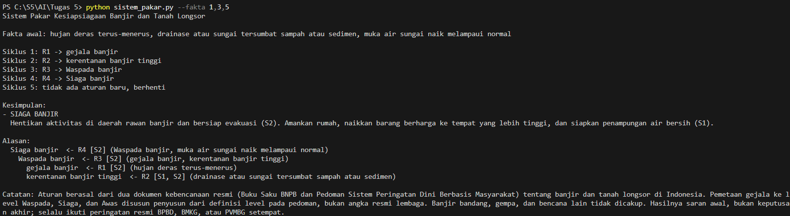
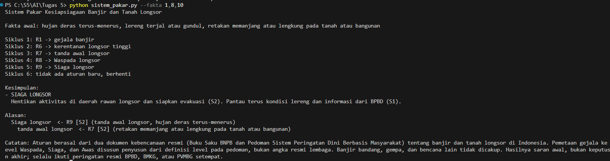
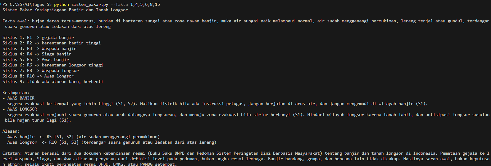
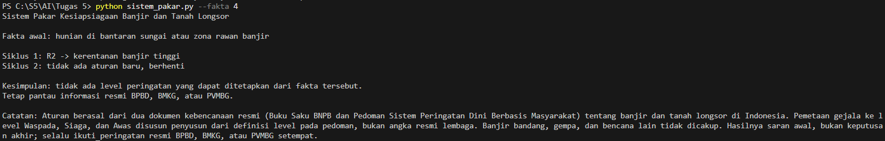

# Tugas 5 — Sistem Pakar Kesiapsiagaan Banjir dan Tanah Longsor

**Nama:** Elsa Ayu Ramadani
**NIM:** F1D02410005
**Mata kuliah:** Kecerdasan Buatan

## 1. Topik dan cara menjalankan

Topik: kesiapsiagaan banjir dan tanah longsor. Program menerima gejala dan kondisi lingkungan dari pengguna, lalu menetapkan level peringatan (Waspada, Siaga, atau Awas) beserta saran tindakan dan alasannya.

- Bahasa: Python 3.8 atau lebih baru, tanpa library tambahan.
- File: `sistem_pakar.py` (mesin) dan `kb_banjir_longsor.json` (aturan).

Mode tanya jawab:

```
python sistem_pakar.py
```

Mode cepat: jawaban "ya" langsung dituliskan lewat nomor fakta, tanpa tanya jawab. Mode ini saya pakai untuk menjalankan kasus uji.

```
python sistem_pakar.py --fakta 1,3,5
```

## 2. Sumber dan aturan

Sumber:

- S1: Pusat Data Informasi dan Humas BNPB. *Buku Saku Tanggap Tangkas Tangguh Menghadapi Bencana*. Jakarta: BNPB, cetakan ketiga November 2018. ISBN 978-602-5693-05-2. https://sma.kemdikbud.go.id/data/files/buku/Buku_Saku_Siaga_Bencana_bnpb_2019.pdf. Diakses 15 November 2026.
- S2: Pemerintah Provinsi Lampung. (t.t.). *Pedoman Sistem Peringatan Dini Berbasis Masyarakat (Informasi Tentang Prosedur Peringatan Dini dan Prosedur Evakuasi Keadaan Darurat)*. https://ppid.lampungprov.go.id/dokumen/1665756716001.pdf. Diakses 15 November 2026.

Aturan:

| Aturan | IF | THEN | Sumber |
| ------ | -- | ---- | ------ |
| R1 | hujan deras terus-menerus **OR** pasang laut tinggi disertai badai | gejala banjir | S2 |
| R2 | drainase atau sungai tersumbat sampah atau sedimen **OR** hunian di bantaran sungai atau zona rawan banjir | kerentanan banjir tinggi | S1, S2 |
| R3 | gejala banjir **AND** kerentanan banjir tinggi | Waspada banjir | S2 |
| R4 | Waspada banjir **AND** muka air sungai naik melampaui normal | Siaga banjir | S2 |
| R5 | air sudah menggenangi permukiman **OR** ada sirine atau instruksi evakuasi dari BPBD | Awas banjir | S1, S2 |
| R6 | lereng terjal atau gundul **OR** ada pemotongan lereng atau getaran pada lereng | kerentanan longsor tinggi | S1, S2 |
| R7 | retakan memanjang atau lengkung **OR** lereng/dinding menggembung **OR** rembesan atau mata air baru **OR** air rembesan tiba-tiba keruh **OR** pohon/tiang miring searah lereng | tanda awal longsor | S2 |
| R8 | hujan deras terus-menerus **AND** kerentanan longsor tinggi | Waspada longsor | S1, S2 |
| R9 | tanda awal longsor **AND** hujan deras terus-menerus | Siaga longsor | S2 |
| R10 | suara gemuruh atau ledakan dari atas lereng **OR** runtuhan atau aliran butiran tanah mendadak **OR** ada sirine atau instruksi evakuasi | Awas longsor | S1, S2 |

Rantai aturan: R1 + R2 → R3 → R4 (banjir), R6 → R8 (longsor), dan R7 → R9.

### Daftar fakta

Program menanyakan fakta-fakta berikut satu per satu. Pada mode cepat, fakta bisa ditulis dengan nomornya atau nama lengkapnya, dipisah koma.

| No | Fakta | Dipakai di |
| -- | ----- | ---------- |
| 1 | hujan deras terus-menerus | R1, R8, R9 |
| 2 | pasang laut tinggi disertai badai | R1 |
| 3 | drainase atau sungai tersumbat sampah atau sedimen | R2 |
| 4 | hunian di bantaran sungai atau zona rawan banjir | R2 |
| 5 | muka air sungai naik melampaui normal | R4 |
| 6 | air sudah menggenangi permukiman | R5 |
| 7 | ada sirine atau instruksi evakuasi dari BPBD | R5, R10 |
| 8 | lereng terjal atau gundul | R6 |
| 9 | ada pemotongan lereng atau getaran pada lereng | R6 |
| 10 | retakan memanjang atau lengkung pada tanah atau bangunan | R7 |
| 11 | lereng atau dinding bangunan menggembung | R7 |
| 12 | rembesan atau mata air baru muncul di lereng | R7 |
| 13 | air rembesan tiba-tiba keruh bercampur lumpur | R7 |
| 14 | pohon atau tiang miring searah lereng | R7 |
| 15 | terdengar suara gemuruh atau ledakan dari atas lereng | R10 |
| 16 | terjadi runtuhan atau aliran butiran tanah mendadak | R10 |

Fakta turunan (hasil aturan, tidak ditanyakan): gejala banjir, kerentanan banjir tinggi, kerentanan longsor tinggi, tanda awal longsor, dan enam level kesimpulan (Waspada, Siaga, Awas untuk banjir dan longsor).

## 3. Metode: Forward Chaining

Forward chaining dipilih karena pengguna datang dengan data yang sudah terlihat di lapangan (hujan, retakan, genangan, dan sebagainya), lalu program menurunkan level peringatan dari data itu. Pengguna tidak punya satu dugaan tunggal yang harus dibuktikan, dan jenis bencananya (banjir atau longsor) bisa terjadi bersamaan, sehingga cocok diturunkan dari fakta ke kesimpulan. Langkahnya:

1. Memori kerja diisi fakta yang dijawab "ya".
2. Cari aturan yang syaratnya terpenuhi dan hasilnya belum ada di memori.
3. Jalankan aturan pertama yang cocok (urutan di file), tambahkan hasilnya ke memori, catat aturan asalnya.
4. Ulangi sampai tidak ada aturan baru. Aturan yang hasilnya sudah ada tidak dijalankan lagi, sehingga program pasti berhenti.
5. Dari kesimpulan yang tercapai, ditampilkan level tertinggi untuk tiap jenis bencana, beserta alasan (aturan, sumber, dan fakta yang dipakai).

Mode `dan` berarti semua syarat harus ada di memori, mode `atau` berarti salah satu cukup. Program juga memeriksa file aturan saat dimuat (id unik, mode sah, sumber terdaftar).

## 4. Kasus uji

| # | Fakta "ya" | Kesimpulan |
| - | ---------- | ---------- |
| 1 | hujan deras terus-menerus, drainase tersumbat, muka air sungai naik (`--fakta 1,3,5`) | Siaga banjir |
| 2 | hujan deras terus-menerus, lereng terjal atau gundul, retakan pada tanah (`--fakta 1,8,10`) | Siaga longsor |
| 3 | hujan deras, hunian di bantaran sungai, muka air naik, air menggenangi permukiman, lereng terjal, suara gemuruh (`--fakta 1,4,5,6,8,15`) | Awas banjir dan Awas longsor |
| 4 | hunian di bantaran sungai saja (`--fakta 4`) | tidak ada level peringatan (kasus negatif) |









## 5. Batas keberlakuan

Aturan berasal dari dua dokumen kebencanaan resmi (Buku Saku BNPB 2018 dan Pedoman Sistem Peringatan Dini Berbasis Masyarakat) tentang banjir dan tanah longsor di Indonesia. Pemetaan gejala ke level Waspada, Siaga, dan Awas disusun penyusun dari definisi level pada pedoman, bukan angka resmi lembaga. Banjir bandang, gempa, dan bencana lain tidak dicakup. Hasilnya saran awal, bukan keputusan akhir; selalu ikuti peringatan resmi BPBD, BMKG, atau PVMBG setempat. Catatan ini juga ditampilkan oleh program.

## 6. Penggunaan alat bantu AI

Claude dipakai untuk membantu mencari sumber, menyusun kerangka aturan, dan menulis kode serta README. Aturan dan kode sudah saya baca dan uji sendiri.